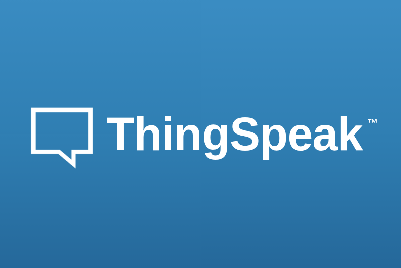

# ThingSpeak for Gladys Assistant



An external integration for [Gladys Assistant](https://gladysassistant.com) that reads your
[ThingSpeak](https://thingspeak.mathworks.com) channels as Gladys sensors, and writes entries to a
channel from your scenes.

## Features

- One device per channel (public, or private with its read API key), one sensor per named field, and
  the date and time of the last entry.
- The unit is read at the end of the field name (`Temperature (°C)`, `Pressure [hPa]`, `Humidity %`):
  temperature, humidity, pressure, light, voltage, power, current, energy, CO2, speed and rain get the
  matching Gladys sensor; any other field is a generic sensor.
- Scene trigger **ThingSpeak channel silent or back**: a channel got no entry for the configured
  delay, or gets entries again.
- Scene action **Publish to ThingSpeak**: one entry (eight fields and the status), fixed values or
  values read by the previous actions, spaced by 15 s per write key for the free plan.
- Dashboard widget **ThingSpeak channels**: the age of the last entry of every channel, or the live
  fields of one channel.
- English, French, German and Spanish.

## Requirements

- Gladys Assistant 5.1.0 or later, with Internet access.
- The ids of the channels to follow; the read API key of the private ones; the write API key of a
  channel to write to it.

## Installation

1. In Gladys, open **Integrations → Install from GitHub** and enter
   `https://github.com/guim31/gladys-thingspeak`.
2. In the **Configuration** tab, enter the channel ids (and the read API keys of the private
   channels), then **Test the connection**.
3. Add the devices from the **Discover** tab.

The user documentation is in [`docs/`](docs/en.md) (English, French, German, Spanish).

## How it works

At each refresh (1 to 15 minutes, 2 by default), one `GET /channels/<id>/feeds.json?results=100`
per channel returns the channel settings and its last 100 entries; each field keeps its newest
value in that window, and a field missing from it is asked once through
`/channels/<id>/fields/<n>/last.json`. Devices are keyed on the channel id, features on the field
number. Gladys does not poll the devices (`should_poll: false`): the container reads ThingSpeak on
its own timer. Only the devices added to Gladys receive states, only when a value changes, with a
heartbeat every 6 hours while the channel gets entries.

The scene action posts to `/update`. ThingSpeak answers the entry id, or `0` when it refuses the
entry (wrong key, or entries too close together): the integration queues the entries of a write key
15 seconds apart, three at most (a fourth is refused before the action timeout).

## Checked on the real ThingSpeak, and what was not

Tested against the real API on 22/11/2026, from the Docker image run within the Gladys sandbox
constraints (read-only, no capability, 256 MB): public channels 9, 12397 (MathWorks weather station)
and 276330 (fields never written lately), a private channel read without its key (clean error), an
unknown channel, and a network cut. The recorded answers are kept in `test/fixtures/thingspeak/`.

Not checked: writing to a real channel (no account; tested against a local fake server answering
like ThingSpeak), a private channel read with its key, the paid plans, and an actual Gladys instance
(the tests use the fake Gladys of the SDK). Feedback welcome in the
[issues](https://github.com/guim31/gladys-thingspeak/issues).

## Limitations

- ThingSpeak free plan: one entry every 15 seconds per channel, 3 million messages a year. One
  minute is the shortest refresh interval offered.
- 8 fields per channel, 20 channels. A field holding text gives no value.
- Latitude, longitude and elevation are ignored.

## Development

```bash
npm ci
npm run format:check && npm run lint && npm test
npx -y github:GladysAssistant/integration-store --skip-image-check .
```

See [`CLAUDE.md`](CLAUDE.md) for the project rules. Releases go through the **Release** workflow
(Actions → Release), which bumps the version, tags and publishes the image.

## Credits

- Built on the official [integration template](https://github.com/GladysAssistant/integration-template-js)
  and [SDK](https://github.com/GladysAssistant/integration-sdk-js) of Gladys Assistant.
- Behaviour of the API checked against the
  [ThingSpeak REST API documentation](https://www.mathworks.com/help/thingspeak/rest-api.html) and the
  Home Assistant [`thingspeak`](https://www.home-assistant.io/integrations/thingspeak/) integration
  (Apache 2.0), which only writes.
- Logo on the cover: ThingSpeak website (thingspeak.mathworks.com), trademark of The MathWorks, Inc.

## Disclaimer

Not affiliated with, endorsed by or sponsored by MathWorks. ThingSpeak is a trademark of The
MathWorks, Inc.

## License

[Apache 2.0](LICENSE).
